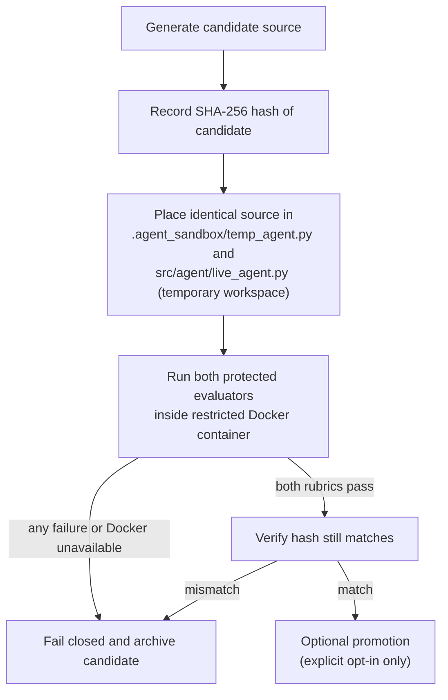

# Contributing to karapathy-loop

Thank you for your interest in contributing to **karapathy-loop**.

This guide covers the project's architecture, development environment, testing strategy, security requirements and contribution workflow. Whether you are fixing a bug, improving the evaluation system, strengthening security or experimenting with AI-driven software improvement, contributions are welcome.

> [!IMPORTANT]
> Reliability and security take priority over increasing the autonomy of the system. Changes that weaken evaluation, isolation or promotion safeguards will not be accepted, even if they make a test pass.

## Table of contents

1. [About the project](#1-about-the-project)
2. [Project architecture](#2-project-architecture)
3. [Candidate evaluation lifecycle](#3-candidate-evaluation-lifecycle)
4. [Development environment](#4-development-environment)
5. [Running tests](#5-running-tests)
6. [Contribution guidelines](#6-contribution-guidelines)
7. [Git and promotion safeguards](#7-git-and-promotion-safeguards)
8. [Documentation requirements](#8-documentation-requirements)
9. [Suggested contribution areas](#9-suggested-contribution-areas)
10. [Submitting a contribution](#10-submitting-a-contribution)
11. [Security disclosures](#11-security-disclosures)
12. [Project status](#12-project-status)

---

## 1. About the project

`karapathy-loop` is an experimental Recursive Self-Improvement (RSI) framework. It explores how an AI agent can propose modifications to its own Python software scaffolding, evaluate those modifications, and optionally promote the successful ones.

The improvement process works like this:

1. Inspect the current agent implementation.
2. Generate a proposed code modification using an AI provider.
3. Evaluate the candidate against protected evaluation rubrics.
4. Archive unsuccessful candidates for analysis.
5. Optionally promote a candidate that passes all required checks.
6. Repeat in subsequent generations.

> [!NOTE]
> The project modifies **software code**, not the internal weights of an AI model.

---

## 2. Project architecture

| Component | Path | Role |
| --- | --- | --- |
| Mutation supervisor | `src/loop/main_loop.py` | Coordinates the improvement lifecycle |
| Context engine | `src/context/engine.py` | Manages what is sent to the AI provider |
| Harness | `src/harness/tools.py` | Controlled access to project files and diagnostics |
| Production agent | `src/agent/live_agent.py` | The current agent, and the target for promotion |
| Protected evaluators | `tests/immutable_ruler.py`, `tests/run_challenge.py` | Define the evaluation contract |

### Mutation supervisor: `src/loop/main_loop.py`

The supervisor coordinates the improvement lifecycle. Its responsibilities include:

- Managing generation state.
- Communicating with supported AI providers.
- Constructing mutation prompts.
- Extracting proposed Python source.
- Preparing temporary evaluation workspaces.
- Running protected evaluators inside Docker.
- Archiving unsuccessful candidates.
- Verifying candidate integrity.
- Managing optional Git promotion.

The supervisor **must fail closed** when required evaluation infrastructure is unavailable.

### Context engine: `src/context/engine.py`

The context engine manages the information supplied to the AI provider. Its responsibilities include:

- Maintaining interaction history.
- Counting tokens with `tiktoken`.
- Prioritizing diagnostic information.
- Managing context limits.
- Removing duplicate diagnostic entries.
- Keeping prompts within configured token budgets.

Token counts are estimates and may differ from the tokenizer used by an external AI provider.

### Harness: `src/harness/tools.py`

The harness provides controlled access to project files and diagnostic operations. Its responsibilities include:

- Restricting filesystem access to approved project locations.
- Rejecting traversal outside the repository.
- Protecting sensitive files.
- Disabling host-side evaluator execution through `run_sandbox_sub_test()`.

> [!IMPORTANT]
> Host-side evaluator execution through the harness is **disabled**. The method signature is kept for compatibility, but attempts to execute evaluator scripts through it fail closed.

Filesystem path validation is an application-level security control. It is not a substitute for OS-level process isolation.

### Production agent: `src/agent/live_agent.py`

This is the current production agent. It is the source from which proposed improvements are generated and the target for successful promotion. Changes to this file must satisfy both protected evaluation rubrics.

### Protected evaluation system

The project uses two protected evaluation scripts:

- `tests/immutable_ruler.py`
- `tests/run_challenge.py`

These scripts define the evaluation contract and **must remain unchanged**. Add new regression tests separately, using the `test_*.py` naming convention.

---

## 3. Candidate evaluation lifecycle

Every proposed source modification must be evaluated before promotion.



The supervisor prepares a temporary workspace and places the exact same candidate source in both expected locations:

- `.agent_sandbox/temp_agent.py`
- `src/agent/live_agent.py`

Both unchanged evaluators then run against that candidate inside Docker. The system records a SHA-256 hash of the original candidate source.

> [!WARNING]
> Promotion must use the exact candidate that passed evaluation. A candidate must never be silently modified between evaluation and promotion.

### Evaluation requirements

Candidate evaluation must:

- Execute both protected rubrics.
- Use the same candidate source for both evaluations.
- Run inside the restricted Docker container.
- Mount evaluation inputs read-only.
- Disable container networking.
- Apply CPU, memory and process limits.
- Apply a timeout.
- Avoid passing provider credentials or Git credentials.
- Avoid mounting the host Git directory or the Docker socket.
- Clean up evaluation containers after execution.
- Fail closed if Docker is unavailable or evaluation fails.

Do not replace Docker-backed candidate evaluation with an ordinary Python subprocess. A temporary directory alone does not provide process isolation.

### Host-side evaluator execution

The harness disables host-side evaluator execution through `run_sandbox_sub_test()`. This restriction applies to execution **through the harness**. It does not mean the protected evaluator scripts are incapable of running directly on the host.

Optional manual evaluator commands can still be used to check the current production agent. Those commands execute on the host and **do not provide container isolation**. Do not treat direct host execution as a substitute for Docker-backed candidate evaluation.

### Docker security

The container is a defense-in-depth boundary, not a guarantee against every possible escape. The Docker daemon, host operating system, kernel and container image remain part of the trusted computing base.

Contributors working on the evaluation infrastructure should pay particular attention to:

- Container privileges.
- Bind mounts and filesystem permissions.
- Image provenance and digest pinning.
- Secret exposure.
- Network isolation.
- Resource exhaustion.
- Container cleanup.
- Timeout handling.

Never weaken these protections to make a test pass.

---

## 4. Development environment

### Requirements

The project targets Windows, macOS and Linux.

The current development and verification record covers **Windows with Python 3.12 and Docker Desktop using WSL2 Linux containers**. macOS and Linux compatibility are development goals and must be tested on their native environments before being described as fully verified.

You will need:

- Python 3.12
- Git
- Docker Engine or Docker Desktop with Linux container support
- A supported AI provider account, only for live supervisor experiments

The normal regression test suite should not require provider credentials or live network access.

### Clone the repository

If you plan to submit changes, [fork the repository](https://github.com/axomiyaindie/karapathy-loop/fork) first and clone your fork. The commands work in PowerShell, Terminal and other shells:

```bash
git clone https://github.com/<your-username>/karapathy-loop.git
cd karapathy-loop
```

### Create a virtual environment

**Windows (PowerShell)**

```powershell
py -3.12 -m venv .venv
.\.venv\Scripts\Activate.ps1
```

**macOS or Linux (Terminal)**

```bash
python3.12 -m venv .venv
source .venv/bin/activate
```

### Install dependencies

On all platforms:

```bash
python -m pip install --upgrade pip
python -m pip install -r requirements.txt
```

### Configure local environment variables

Create a local configuration file.

**Windows (PowerShell)**

```powershell
Copy-Item .env.example .env
```

**macOS or Linux (Terminal)**

```bash
cp .env.example .env
```

Edit `.env` with your local provider configuration. Use `.env.example` for placeholder configuration only.

> [!CAUTION]
> Never commit `.env`, API keys, tokens, passwords or other credentials.

---

## 5. Running tests

Run the regression suite from the repository root:

```bash
python -m pytest -v
```

The latest reported Windows regression run completed with **33 passed, 0 failed**. This is a Windows result, not proof that the suite passes on every supported operating system.

### Optional manual evaluator checks

The protected evaluators can also be run directly against the current production agent. First, prepare the expected candidate location.

**Windows (PowerShell)**

```powershell
New-Item -ItemType Directory -Force .agent_sandbox | Out-Null
Copy-Item src\agent\live_agent.py .agent_sandbox\temp_agent.py -Force

python tests\immutable_ruler.py
python tests\run_challenge.py
```

**macOS or Linux (Terminal)**

```bash
mkdir -p .agent_sandbox
cp src/agent/live_agent.py .agent_sandbox/temp_agent.py

python tests/immutable_ruler.py
python tests/run_challenge.py
```

These commands execute the unchanged evaluator scripts directly on the host against the current production agent. They are optional manual checks and **do not provide container isolation**. Proposed candidates must be evaluated through the supervisor's Docker-backed workflow.

### Testing requirements

Regression tests must:

- Be deterministic.
- Avoid live AI provider requests.
- Avoid real GitHub pushes.
- Avoid autonomous improvement loops.
- Avoid modifying production files.
- Avoid modifying protected evaluation scripts.
- Use mocks or temporary directories when testing external dependencies.
- Clean up temporary files and resources.
- Verify failure conditions as well as successful execution.

When changing the supervisor, add regression tests for the relevant failure cases, for example:

- Empty or invalid model responses.
- Provider authentication failures.
- Candidate hash mismatches.
- Evaluation timeouts.
- Docker execution failures.
- Failed candidate archiving.
- Dirty Git working trees.
- Git commit failures.
- Git push failures.
- Secret detection and redaction.
- Workspace permission failures.
- Cross-platform path handling.

Do not introduce a test that makes an actual provider request or performs a real remote Git operation.

### Cross-platform testing

Run the regression suite on the operating systems affected by your change. The platform matrix is:

| Platform | Verification status |
| --- | --- |
| Windows | Regression suite passed: 33 tests |
| macOS | Not yet verified |
| Linux | Not yet verified |

Docker integration must also be checked separately. Passing mocked or unit tests does not prove that real Docker bind mounts, permissions, timeouts and cleanup work on every platform.

---

## 6. Contribution guidelines

### Before making changes

1. Read the relevant source files.
2. Understand the existing public interfaces.
3. Check the current Git working tree.
4. Identify the component affected by your change.
5. Review related tests before modifying implementation code.

Preserve existing public interfaces unless a change is explicitly justified and documented. Prefer focused, incremental modifications over unnecessary architectural rewrites.

### Adding regression tests

Place new tests in the `tests/` directory and name them `test_*.py`. For example:

```text
tests/
    immutable_ruler.py        (protected, do not modify)
    run_challenge.py          (protected, do not modify)
    conftest.py
    test_context_engine.py
    test_harness_security.py
    test_supervisor.py
```

If you discover a weakness in a protected evaluator, document the finding and discuss the required change separately rather than silently changing the rubric.

### Code quality

Contributions should prioritize:

- Clear and maintainable Python code.
- Small, focused changes.
- Explicit error handling.
- Deterministic behavior.
- Secure filesystem operations.
- Resource and timeout limits.
- Testable interfaces.
- Useful documentation.
- Backward compatibility.

Avoid introducing unnecessary dependencies.

---

## 7. Git and promotion safeguards

Git promotion is a sensitive part of this project. The supervisor must never overwrite unrelated developer changes.

Before enabling commits:

1. Verify that the target production file is clean.
2. Verify that its Git index entry is clean.
3. Confirm that the candidate hash matches the evaluated source.
4. Stage only `src/agent/live_agent.py`.
5. Commit only after both protected rubrics pass.

> [!WARNING]
> Never use broad commands such as `git reset --hard` or `git clean -fd` in promotion or recovery code. They can destroy unrelated user work. Recovery operations must target only the specific file and index entry involved in the failed promotion.

### Push behavior

A failed remote push must leave a successful local commit intact. Do not automatically undo a successful local commit simply because an upstream push failed.

### Default promotion configuration

The safe defaults are:

```dotenv
RSI_AUTO_COMMIT=false
RSI_AUTO_PUSH=false
```

Automatic commits require explicit opt-in, and remote pushes require a separate explicit opt-in. Do not enable automatic promotion as part of ordinary regression testing.

---

## 8. Documentation requirements

Update documentation when a contribution changes:

- Public interfaces.
- Configuration options.
- Environment variables.
- Installation instructions.
- Evaluation behavior.
- Security boundaries.
- Dependencies.
- Development workflows.

Keep the README beginner-friendly. Use this document for technical architecture, development details, testing procedures and contribution requirements.

Documentation must distinguish between:

- Features that are implemented.
- Features that have passed automated tests.
- Features that have passed actual integration tests.
- Features that are planned but not yet verified.

Do not describe cross-platform behavior as verified unless the relevant platform tests have actually been completed.

---

## 9. Suggested contribution areas

These are suggestions, not a requirement to implement any particular feature.

| Area | Ideas |
| --- | --- |
| **Evaluation and sandbox security** | Stronger container isolation; verified and pinned container images; better timeout and cleanup handling; more security regression tests; improved failure reporting |
| **Context engineering** | Better diagnostic prioritization; more efficient context compression; improved token-budget management; duplicate detection and history handling |
| **Mutation supervisor** | More reliable provider response handling; better candidate validation; stronger promotion safeguards; improved mutation metadata and archiving |
| **Testing and reliability** | More regression coverage; better failure simulation; cross-platform compatibility; improved integration testing |
| **Documentation** | Clearer setup instructions; better architecture explanations; more examples; troubleshooting guides |

---

## 10. Submitting a contribution

### Step 1: Create a branch

```bash
git checkout -b feature/your-change
```

### Step 2: Make a focused change

Modify only the files required for your contribution.

### Step 3: Add regression tests

Create or update tests without changing the protected rubrics.

### Step 4: Run the test suite

```bash
python -m pytest -v
```

### Step 5: Check your diff

```bash
git diff --check
git status
git diff
```

Review the final changes and make sure no secrets, generated runtime files or unrelated modifications are included.

### Step 6: Submit a pull request

Push your feature branch to your fork and open a pull request against the [main repository](https://github.com/axomiyaindie/karapathy-loop).

Describe:

- What you changed.
- Why the change is needed.
- Which files were affected.
- Which tests you added or ran.
- Any compatibility or security implications.

For security-sensitive changes, explain the threat being addressed and how the new implementation prevents it.

### Pull request checklist

- [ ] The change is focused and limited to what is needed.
- [ ] `python -m pytest -v` passes.
- [ ] New or changed behavior has regression tests, including failure cases.
- [ ] `tests/immutable_ruler.py` and `tests/run_challenge.py` are unchanged.
- [ ] No secrets, `.env` files or generated runtime files are included.
- [ ] Docker isolation and fail-closed behavior are not weakened.
- [ ] Documentation is updated where needed.
- [ ] Cross-platform claims reflect what was actually tested.

---

## 11. Security disclosures

Please do **not** publish exploitable security vulnerabilities, credentials, API keys or sensitive information in public issues.

Provide enough information for the maintainers to investigate the problem safely. If the repository has private vulnerability reporting enabled, use the **Security** tab and choose **Report a vulnerability**. Otherwise, contact the maintainer through their GitHub profile without including exploit details in public.

Never include real secrets in bug reports, test fixtures or pull requests.

---

## 12. Project status

`karapathy-loop` is an experimental project under active development. Its goal is to explore controlled, test-driven approaches to AI-driven software improvement.

Contributions are welcome, but reliability and security take priority over increasing the autonomy of the system.

**Thank you for helping improve karapathy-loop.**