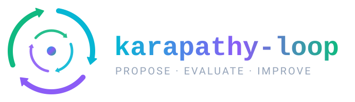
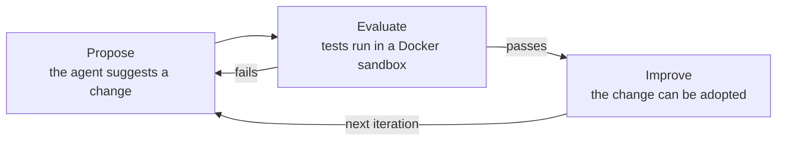

<p align="center">
  
</p>

<h1 align="center">karapathy-loop</h1>

<p align="center">
  <strong>A recursive self-improvement agent framework</strong><br>
  <em>Propose · Evaluate · Improve</em>
</p>

<p align="center">
  <a href="LICENSE"></a>
  
  
  
  
  <a href="https://github.com/axomiyaindie/karapathy-loop/stargazers"></a>
</p>

<p align="center">
  <a href="#getting-started">Getting started</a> ·
  <a href="#how-it-works">How it works</a> ·
  <a href="#safety">Safety</a> ·
  <a href="#troubleshooting">Troubleshooting</a> ·
  <a href="CONTRIBUTING.md">Contributing</a>
</p>

---

## What is this?

**karapathy-loop** is an independent experiment in how an AI agent can **propose improvements to its own software, test those improvements, and optionally adopt the ones that succeed.**

It is a small, hackable framework built around one idea: a loop where the agent improves the agent.

> [!WARNING]
> This is an **experimental** project. AI-generated changes may contain errors. Tests and Docker restrictions reduce risk but **do not guarantee security**. Always review proposed changes and keep backups of important files.

## How it works



1. **Propose:** the agent asks an AI provider (OpenAI or Anthropic) for an improvement to its own code.
2. **Evaluate:** the candidate is tested by the supervisor in a **Docker-backed sandbox**, away from your host.
3. **Improve:** if the candidate passes, the change can be adopted. Automatic Git commits and pushes are **disabled by default**.

## Key files

| Path | Purpose |
| --- | --- |
| `src/loop/main_loop.py` | The supervisor that runs the propose, evaluate and improve loop |
| `src/agent/live_agent.py` | The current production agent |
| `tests/immutable_ruler.py` | Fixed evaluator for candidate agents |
| `tests/run_challenge.py` | Challenge runner |
| `tests/test_supervisor.py` | Regression tests for the supervisor |
| `.env.example` | Template for your API key and model settings |
| `AUDIT.md` | Audit notes |

## Getting started

### Requirements

| Requirement | Notes |
| --- | --- |
| **OS** | Windows 10/11, macOS or Linux |
| **Python** | 3.12 |
| **Git** | Any recent version |
| **Docker** | Docker Desktop, or Docker Engine with Linux container support |
| **API key** | OpenAI or Anthropic, only for live experiments |

> [!NOTE]
> You do **not** need an API key to run the regression test suite.

### 1. Download the project

<details open>
<summary><b>Windows (PowerShell)</b></summary>

```powershell
git clone https://github.com/axomiyaindie/karapathy-loop.git
cd karapathy-loop
```

</details>

<details>
<summary><b>macOS / Linux (Terminal)</b></summary>

```bash
git clone https://github.com/axomiyaindie/karapathy-loop.git
cd karapathy-loop
```

</details>

### 2. Create a Python environment

<details open>
<summary><b>Windows (PowerShell)</b></summary>

```powershell
py -3.12 -m venv .venv
.\.venv\Scripts\Activate.ps1
```

</details>

<details>
<summary><b>macOS / Linux (Terminal)</b></summary>

```bash
python3.12 -m venv .venv
source .venv/bin/activate
```

</details>

### 3. Install dependencies

On all platforms:

```bash
python -m pip install --upgrade pip
python -m pip install -r requirements.txt
```

### 4. Configure your API key

<details open>
<summary><b>Windows (PowerShell)</b></summary>

```powershell
Copy-Item .env.example .env
notepad .env
```

</details>

<details>
<summary><b>macOS / Linux (Terminal)</b></summary>

```bash
cp .env.example .env
# then open .env in your preferred editor
```

</details>

Add your API key and the model identifier supported by your provider, using the variable names in `.env.example`.

> [!CAUTION]
> Never publish your `.env` file, never commit it to Git, and never share your API credentials.

### 5. Start Docker

- **Windows / macOS:** install and open [Docker Desktop](https://www.docker.com/products/docker-desktop/).
- **Linux:** install and start Docker Engine.

Wait until Docker reports that its engine is running. The supervisor needs it to evaluate candidate code.

### 6. Run the tests

```bash
python -m pytest -v
```

Latest reported result on **Windows**: **33 passed, 0 failed**.

> [!NOTE]
> macOS and Linux still need their own verification. See [Platform status](#platform-status).

<details>
<summary><b>Optional: run the evaluators manually</b></summary>

<br>

These commands run the evaluators directly on the **host** against the current production agent. They **do not** provide container isolation. Candidate isolation is tested only through the supervisor's Docker-backed evaluation.

**Windows (PowerShell)**

```powershell
New-Item -ItemType Directory -Force .agent_sandbox | Out-Null
Copy-Item src\agent\live_agent.py .agent_sandbox\temp_agent.py -Force

python tests\immutable_ruler.py
python tests\run_challenge.py
```

**macOS / Linux (Terminal)**

```bash
mkdir -p .agent_sandbox
cp src/agent/live_agent.py .agent_sandbox/temp_agent.py

python tests/immutable_ruler.py
python tests/run_challenge.py
```

The harness disables host-side evaluator execution through `run_sandbox_sub_test()`.

</details>

### 7. Start karapathy-loop

From the activated Python environment:

```bash
python src/loop/main_loop.py
```

> [!IMPORTANT]
> Starting the supervisor makes **live AI provider requests** and may **incur API costs**. Keep automatic Git commits and pushes **disabled** while experimenting.

## Safety

- Candidate code is evaluated through a **Docker-backed workflow**, not directly on your host.
- Automatic Git commits and pushes are **off by default**.
- A regression suite covers the supervisor.
- You should still **review every proposed change** yourself.

Docker isolation is defense in depth. It is not a guarantee against every possible container escape.

## Troubleshooting

<details>
<summary><b>PowerShell blocks <code>Activate.ps1</code> ("running scripts is disabled")</b></summary>

<br>

Allow scripts for the current terminal session only, then activate again:

```powershell
Set-ExecutionPolicy -Scope Process -ExecutionPolicy Bypass
.\.venv\Scripts\Activate.ps1
```

</details>

<details>
<summary><b>Docker errors such as "cannot connect to the Docker daemon"</b></summary>

<br>

Docker is not running. Start Docker Desktop (or the Docker Engine service on Linux), wait until it reports that the engine is running, and try again.

</details>

<details>
<summary><b>Authentication or model errors from the AI provider</b></summary>

<br>

Check that `.env` exists, that the key is valid, and that the model identifier is one your provider supports. Compare the variable names against `.env.example`.

</details>

## Platform status

| Platform | Status |
| --- | --- |
| Windows (Python 3.12) | Regression suite verified (33 passed) |
| macOS | Intended to work, needs verification |
| Linux | Intended to work, needs verification |

Native macOS and Linux testing is required before full cross-platform support can be claimed. Reports are welcome.

## Contributing

Contributions, bug reports and ideas are welcome. Read [CONTRIBUTING.md](CONTRIBUTING.md) for development setup, architecture, testing guidance and contribution guidelines.

## Inspiration

Inspired by the experiments and ideas of [Andrej Karpathy](https://github.com/karpathy).

This is an independent project and is **not affiliated with or endorsed by** Andrej Karpathy.

## License

Released under the [MIT License](LICENSE).

---

<p align="center">
  <strong>Project status:</strong> Experimental · Under active development<br>
  <em>Explore. Experiment. Evaluate. Improve.</em>
</p>